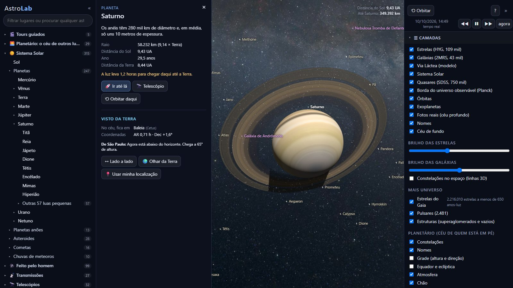
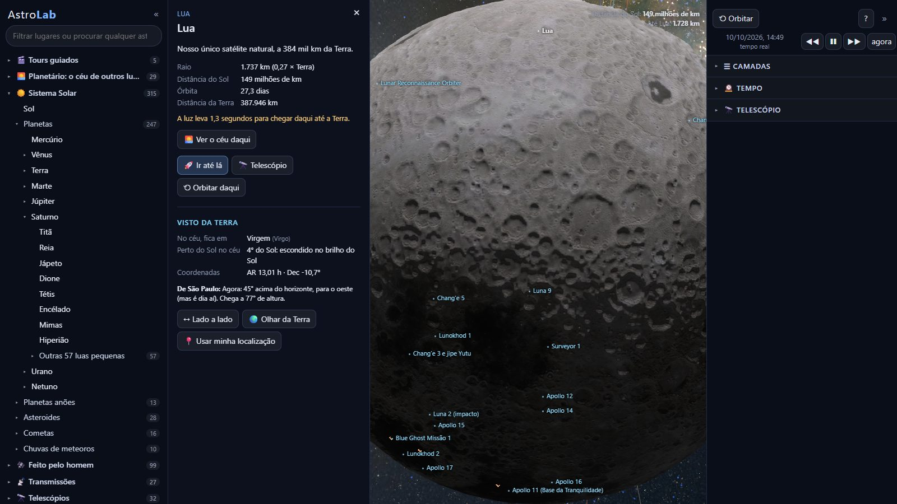
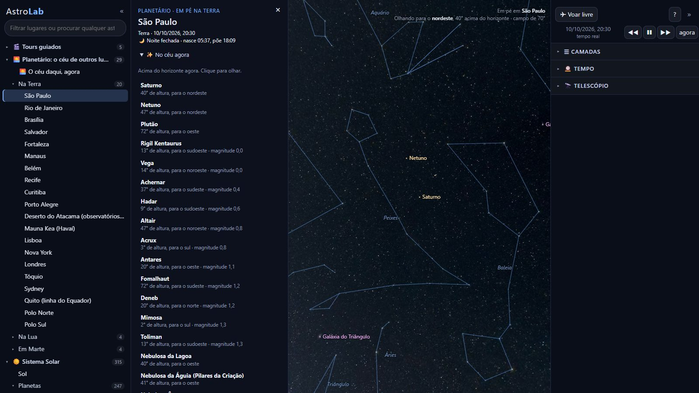
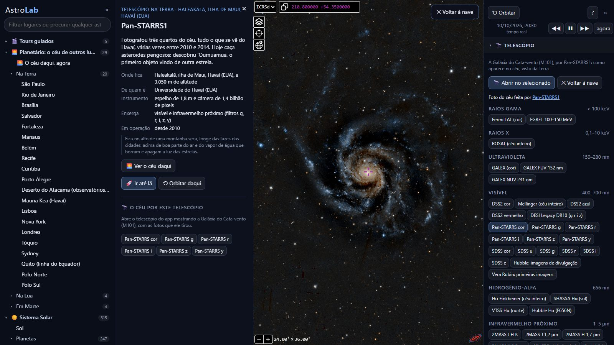

# AstroLab

**O universo real, em 3D, no seu navegador.** Do céu do seu quintal até a borda do universo observável, com dados
de verdade da NASA, da ESA e dos grandes catálogos científicos: os planetas na posição de agora, milhões de estrelas,
milhares de planetas de outras estrelas, as sondas e os satélites onde eles estão, galáxias e quasares a bilhões de
anos-luz.

Feito para passear, aprender e ensinar: tudo em português, com fichas que explicam o que você está vendo e avisam o
que é medido e o que é ilustrativo.



## O que dá para fazer

- **Viajar para mais de 12 mil lugares** escolhidos numa árvore: planetas e as 189 luas, robôs em Marte e na Lua,
  sondas como as Voyager, estrelas com nome, sistemas de exoplanetas, as 88 constelações em 3D, nebulosas,
  buracos negros, galáxias e o universo distante. E procurar qualquer outro astro entre bilhões, pelo SIMBAD.
- **Ver o céu de qualquer lugar:** ficar em pé em São Paulo, no deserto do Atacama, na Lua ou em Marte, na data que
  quiser, com o que está acima do horizonte, as passagens da Estação Espacial e as conjunções do ano.
- **Viajar no tempo:** de 100 mil anos atrás a 100 mil anos à frente (as estrelas se movem e as constelações se
  deformam), eclipses com a sombra no globo e replays de missões como Apollo 11, Voyager e Cassini, com as
  trajetórias reais.
- **Olhar por telescópios de verdade:** mais de 50 fotos do céu inteiro, de raios gama a ondas de rádio, cada uma
  com a ficha do telescópio que a fez, como o Hubble, o Webb, o Pan-STARRS ou o Planck.
- **Acompanhar o que acontece agora:** a Terra vista pelos satélites meteorológicos, o Sol em ultravioleta, as
  últimas fotos dos robôs em Marte, as ondas gravitacionais detectadas e as supernovas deste mês.
- **Tours guiados:** cinco viagens narradas, como "Do seu quarto ao universo observável" e "Existe vida lá fora?".

| | |
|---|---|
|  |  |
| O relevo real da Lua (LRO), com os pousos das missões | O céu de São Paulo à noite, no planetário |



## Os números

| | |
|---|---|
| Estrelas | 109 mil do catálogo HYG e 2,2 milhões do Gaia (ESA), a até 650 anos-luz |
| Exoplanetas | 6.445, com a zona habitável de cada sistema |
| Asteroides e cometas | 1,57 milhão de asteroides e 4.080 cometas, com órbitas reais do JPL |
| Feito pelo homem | 17 mil satélites em volta da Terra e cerca de 40 sondas pelo Sistema Solar |
| Universo distante | 43 mil galáxias, 750 mil quasares e a radiação cósmica de fundo |
| Fenômenos | 282 ondas gravitacionais, 2.481 pulsares, buracos negros e supernovas recentes |

## Como usar

Você precisa de:

- [Node.js](https://nodejs.org) 18 ou mais novo (só para servir os arquivos; não há nada para instalar com `npm`);
- um navegador atual com WebGL 2 (Chrome, Edge ou Firefox) e uma placa de vídeo razoável;
- internet, para as bibliotecas, as fotos do céu, a busca e as transmissões.

```bash
git clone https://github.com/lberendsen/AstroLab.git
cd AstroLab
npm start
```

Depois, abra **http://localhost:8080** no navegador. No Windows, também dá para dar dois cliques em `AstroLab.bat`,
que sobe o servidor e abre o navegador.

Na primeira vez, o servidor baixa os satélites e as trajetórias das sondas (leva um ou dois minutos). Até lá o app
funciona sem eles; recarregue a página depois para vê-los.

### Comandos básicos

| | |
|---|---|
| Arrastar · roda do mouse | girar em volta do alvo · aproximar e afastar |
| Clique · duplo clique | selecionar · viajar até lá |
| `/` | procurar |
| `Tab` | alternar entre orbitar e voar livre (`W A S D`, `Shift` = turbo) |
| `espaço` `,` `.` | pausar, desacelerar e acelerar o tempo |
| `H` | todos os atalhos |

## Para quem quer ir além

- [Documentação](docs/DOCUMENTACAO.md): o que cada parte do app faz, de onde vem cada dado e como atualizar os catálogos.
- [Roteiro](ROADMAP.md): o que já foi feito, fase por fase, e o que vem pela frente.
- **Criar um tour sem programar:** os roteiros são arquivos JSON em `data/tours/` (o formato está na documentação).
- **Testes:** `npm install` e `npm run smoke` abrem o app num navegador sem janela e visitam os principais lugares.

## De onde vêm os dados

NASA (JPL Horizons, Small-Body Database, Exoplanet Archive, GIBS, MAST, DSN), ESA (Gaia, Planck, ESA/Webb e
ESA/Hubble), CDS de Estrasburgo (SIMBAD, HiPS e Aladin Lite), SDSS, 2MASS, CelesTrak, GWOSC, Transient Name Server,
NOAA, EUMETSAT, JMA/NICT, CMA, catálogo HYG, catálogo ATNF de pulsares e Solar System Scope (texturas, CC BY 4.0).
Bibliotecas: [three.js](https://threejs.org) e [Astronomy Engine](https://github.com/cosinekitty/astronomy).
A lista completa, com o que veio de cada fonte, está na [documentação](docs/DOCUMENTACAO.md#dados).

Cada fonte mantém a própria licença e merece o crédito: este projeto só existe porque essas instituições publicam
seus dados abertamente.

## Licença

O código e os textos do AstroLab estão sob a [PolyForm Noncommercial 1.0.0](LICENSE): uso livre e gratuito para
pessoas, escolas, universidades, museus, planetários, ONGs e pesquisa. **Uso comercial depende de autorização** do
autor. Os dados e imagens de terceiros em `data/` e `textures/` seguem as licenças das fontes de origem.

Desenvolvido por Lorenzo Teodoro Berend, com a ajuda do Claude (Anthropic).
